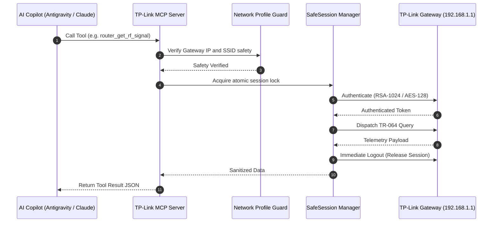

<p align="center">
  <a href="https://github.com/dulithdivisekara/tplink-mcp" target="_blank" rel="noopener noreferrer">
    
  </a>
</p>

<h1 align="center">TP-Link Router MCP Server</h1>

<p align="center">
  Universal, agent-safe Model Context Protocol (MCP 2.x) server connecting TP-Link routers to autonomous AI copilots.
</p>

<p align="center">
  <a href="https://modelcontextprotocol.io/"></a>
  <a href="https://www.npmjs.com/package/tplink-mcp"></a>
  <a href="https://github.com/dulithdivisekara/tplink-mcp/pkgs/container/tplink-mcp"></a>
  <a href="#"></a>
  <a href="LICENSE"></a>
</p>

<p align="center">
  <a href="#overview">Overview</a> &bull;
  <a href="#architecture--modes">Architecture</a> &bull;
  <a href="#project-structure">Structure</a> &bull;
  <a href="#installation">Installation</a> &bull;
  <a href="#usage">Usage</a> &bull;
  <a href="#session-logging--inspection">Logging</a> &bull;
  <a href="#verification-tests">Testing</a> &bull;
  <a href="#security--privacy">Security</a> &bull;
  <a href="#license">License</a>
</p>

---

## Overview

TP-Link Router MCP Server is a production-ready implementation of the Model Context Protocol (MCP 2.x) that grants autonomous AI agents safe, structured access to TP-Link cellular gateways and broadband routers. Supported agent frameworks include Google Antigravity, Claude Desktop, Cursor, and OpenAI Codex.

Conceived during network tuning experiments on Hutch 4G LTE unlimited connections in Malabe, Sri Lanka (near the SLIIT Campus), the server allows AI models to independently audit link telemetry, optimize radio bands, and resolve cellular bufferbloat while guaranteeing zero disruption to concurrent sessions or unauthorized networks.

To satisfy the strict single-administrator concurrency constraint enforced by TP-Link firmware, the server encapsulates every tool invocation within an atomic `SafeSession` context manager that authenticates, executes the request, and logs out immediately. Potentially disruptive tool calls enforce explicit confirmation arguments to prevent AI models from severing active connectivity.

---

## Architecture & Modes

The server provides flexible deployment models across standard process transports, containerized runtimes, and package managers.

| Deployment Target | Transport Mechanism | Runtime Requirements | Isolation Level | Recommended Host |
| :--- | :--- | :--- | :--- | :--- |
| **Python stdio** | JSON-RPC over stdin/stdout | Python 3.10+ | Process-level | Google Antigravity, Cursor, CLI agents |
| **Node.js npx** | Stdio wrapper | Node.js 18+ | Process-level | Claude Desktop, npx environments |
| **Docker Container** | Host-networked container | Docker Engine | Containerized | Headless servers, Kubernetes, Podman |
| **Smithery Registry** | Stdio automation | Smithery CLI | Managed | Automated agent configurations |



---

## Project Structure

```
.
├── tplink_mcp/                 # MCP server and tool registry
│   ├── server.py               # MCP 2.x protocol entrypoint and JSON-RPC router
│   ├── tools/                  # 18 typed MCP tool definitions
│   └── core/                   # Session leasing, network safety, and crypto
├── bin/                        # Node.js binary wrapper for npx distribution
├── Dockerfile                  # Container definition for GHCR deployment
├── smithery.yaml               # Smithery marketplace manifest
├── tests/                      # Automated test suite (63 unit tests)
├── package.json                # npm wrapper configuration
├── pyproject.toml              # Python build and dependency manifest
└── README.md
```

---

## Installation

### Claude Desktop Configuration
Add the server entry to your `claude_desktop_config.json`:

```json
{
  "mcpServers": {
    "tplink-mcp": {
      "command": "npx",
      "args": ["-y", "tplink-mcp"],
      "env": {
        "TPLINK_ROUTER_IP": "http://192.168.1.1",
        "TPLINK_PASSWORD": "your_router_password"
      }
    }
  }
}
```

### Google Antigravity & Cursor Configuration
Configure directly using Python stdio transport:

```json
{
  "mcpServers": {
    "tplink-mcp": {
      "command": "python3",
      "args": ["-m", "tplink_mcp.server"],
      "env": {
        "TPLINK_ROUTER_IP": "http://192.168.1.1",
        "TPLINK_PASSWORD": "your_router_password"
      }
    }
  }
}
```

### Docker Container (Zero-Install)
```bash
docker run -i --rm --network host \
  -e TPLINK_ROUTER_IP="http://192.168.1.1" \
  -e TPLINK_PASSWORD="your_router_password" \
  ghcr.io/dulithdivisekara/tplink-mcp:latest
```

---

## Usage

### Core Tools Catalog

The server exposes 18 typed MCP tools categorized by operational risk:

| Tool Name | Operation | Description | Safety Gate |
| :--- | :--- | :--- | :--- |
| `router_profile_check` | Read | Verifies active Wi-Fi SSID and default gateway | Safe |
| `router_get_status` | Read | Retrieves hardware status, WAN IP, and cellular health | Safe |
| `router_get_rf_signal` | Read | Queries 3GPP RSRP, RSRQ, SNR, and tower parameters | Safe |
| `router_set_cell_lock` | Write | Pins modem to specific EARFCN and PCI base station | Requires `confirm=True` |
| `router_set_lte_band` | Write | Restricts modem to selected frequency band (e.g. Band 3) | Requires `confirm=True` |
| `router_get_data_limit` | Read | Inspects monthly quota, billing day, and live bandwidth | Safe |
| `router_set_data_limit` | Write | Sets monthly billing cycle and data ceiling | Requires `confirm=True` |
| `router_get_connected_clients` | Read | Lists LAN devices with IP, MAC, hostname, and lease | Safe |
| `router_manage_dhcp_reservation` | Write | Adds, deletes, or inspects static DHCP bindings | Requires `confirm=True` (add/del) |
| `router_get_wifi_networks` | Read | Returns 2.4 GHz and 5 GHz wireless configuration | Safe |
| `router_set_wifi_radio` | Write | Enables or disables wireless radio transmitters | Requires `confirm=True` |
| `router_get_led_status` | Read | Queries front panel LEDs and night mode schedule | Safe |
| `router_set_led_night_mode` | Write | Configures automated nighttime LED disablement | Safe |
| `router_run_diagnostic` | Exec | Dispatches router-side WAN, link, and internet tests | Safe |
| `router_set_dns` | Write | Configures custom WAN DNS resolvers | Safe |
| `router_toggle_ipv6` | Write | Enables or disables IPv6 stack | Safe |
| `router_run_ussd` | Exec | Sends interactive USSD query to SIM | Safe |
| `router_read_sms` | Read | Reads incoming and sent SMS messages from SIM card | Safe |
| `router_send_sms` | Write | Dispatches SMS message via cellular modem | Safe |
| `router_reboot` | Exec | Gracefully restarts router hardware | Requires `confirm=True` |

---

## Session Logging & Inspection

The MCP specification mandates clean stdout for JSON-RPC message frames. All server diagnostic logs are routed strictly to stderr or designated files:

- **Audit Log Path**: `~/.config/tplink-router/mcp.log`
- **Stream Live Logs**:
  ```bash
  tail -f ~/.config/tplink-router/mcp.log
  ```

---

## Verification Tests

Run the automated test suite verifying tool schemas, validation handlers, and mock gateway responses:

```bash
python3 -m unittest discover tests
```

```text
Ran 63 tests in 19.603s

OK
```

---

## Security & Privacy

- **SafeSession Isolation**: Eliminates lockout errors on the web administrative portal by guaranteeing immediate atomic session teardown.
- **Disconnection Guardrails**: Destructive commands enforce `confirm=True` to prevent recursive disconnection where an AI agent severs its own connection.
- **Network Profile Validator**: Halts execution if the client is connected to university campus Wi-Fi or unauthorized networks.
- **Credential Segregation**: Credentials are supplied via environment variables or protected configuration files with owner-only (`0600`) POSIX permissions.

---

## License

This project is licensed under the [MIT License](LICENSE).
Author: [Dulith Divisekara](https://github.com/dulithdivisekara).
